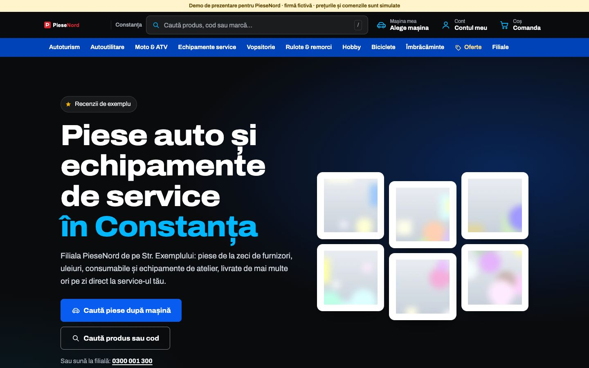
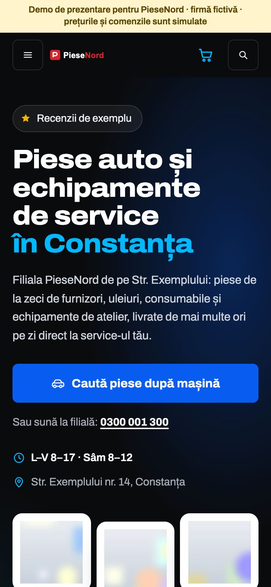
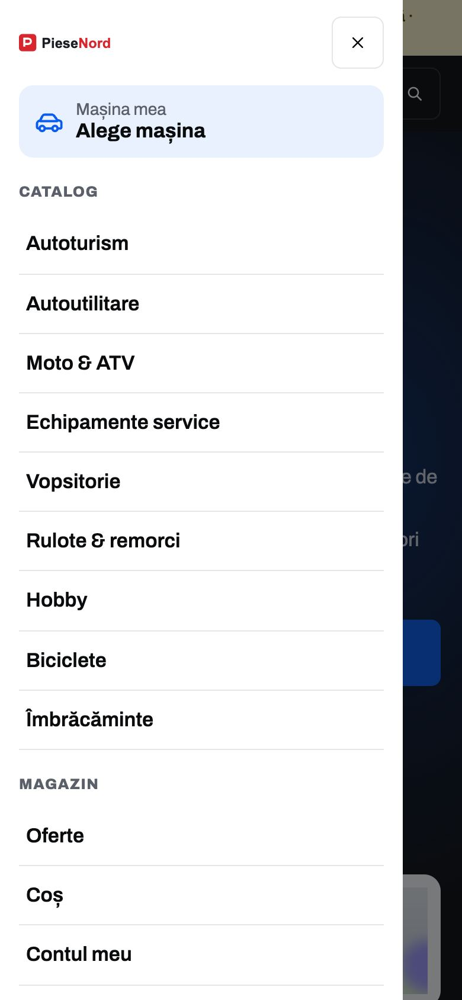
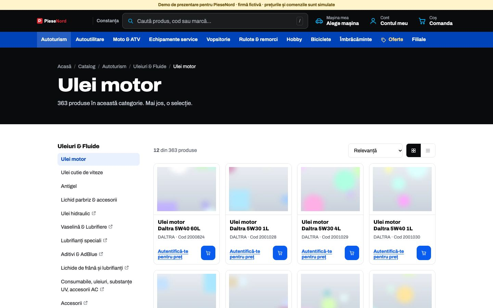
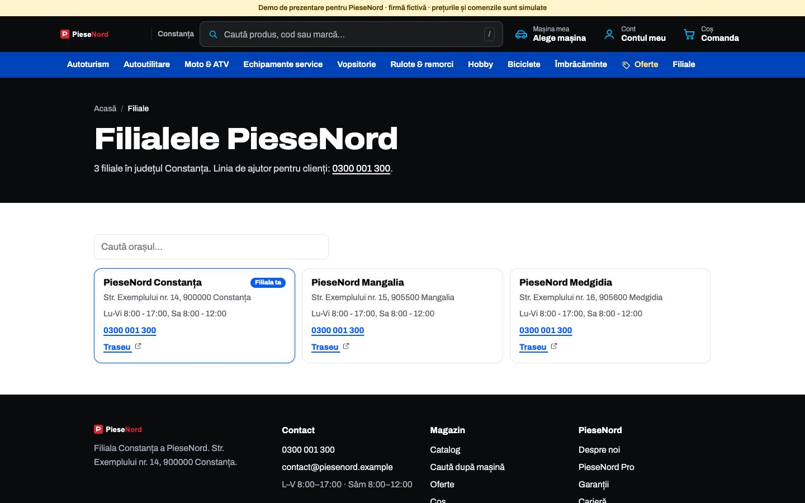
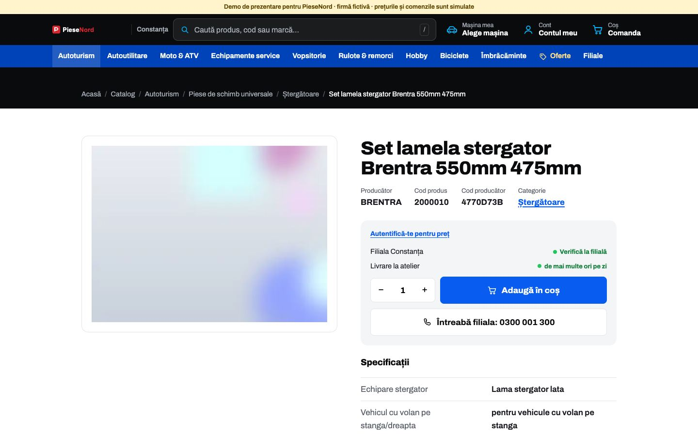

# PieseNord

Magazin demo de piese auto: catalog, căutare după mașină, coș și cont simulate în browser.

> Proiect demonstrativ. Firma, adresa, telefoanele, emailurile și recenziile sunt fictive. Orice asemănare cu o firmă reală este întâmplătoare.

## Capturi de ecran

| Prima pagină, telefon | Meniul pe telefon | Categorie cu filtre | Filiale | Pagină de produs |
|---|---|---|---|---|
|  |  |  |  |  |

## Tehnologii

HTML, CSS și JavaScript simplu, peste 1.200 de pagini statice.

## Decizii tehnice

- Fiecare produs și fiecare categorie au pagină proprie, generată static: se încarcă instant și poate fi găzduită oriunde, chiar și pe un hosting fără server.
- Indexul de căutare (`assets/search.js`, ~1.500 de intrări) se încarcă abia când deschizi căutarea, ca să nu îngreuneze prima pagină.
- Coșul, contul și comenzile sunt simulate în localStorage și se sincronizează între file deschise.
- Filtrele din categorii lucrează pe datele din atributele `data-facets` ale cardurilor, fără cereri la server.
- Catalogul, mărcile, codurile și prețurile sunt generate pentru demo, la fel ca imaginile produselor.
- Accesibilitate: link „Sari la conținut”, mesaje anunțate cititoarelor de ecran (aria-live), focus vizibil la navigarea cu tastatura.
- Animațiile se reduc sau se opresc pentru cine a setat „reducerea mișcării” în sistem (`prefers-reduced-motion`).
- Imaginile din afara ecranului se încarcă abia când e nevoie de ele (`loading="lazy"`).

## Rulare

Site static: deschide `index.html` în browser sau rulează un server local, de exemplu `npx serve .`.

## Cum a fost realizat

Proiectul a fost conceput și dezvoltat de Cristian Lucaci. În procesul de creație am folosit și instrumente de inteligență artificială, ca sprijin la scrierea codului, la texte și la verificări. Deciziile de design, alegerile tehnice și forma finală îmi aparțin.

## Licență

Codul este publicat sub licența [MIT](LICENSE), © 2026 Cristian Lucaci.

Resursele terțe incluse (fonturi, biblioteci, fotografii sau modele 3D cu licență liberă) își păstrează licențele proprii, menționate lângă fișiere sau în pagină. Imaginile fără sursă menționată sunt grafică generată pentru acest proiect.
